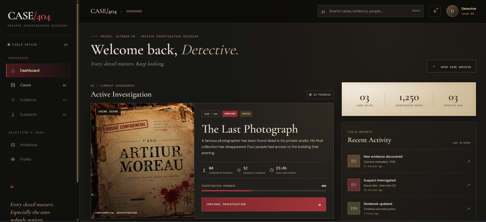
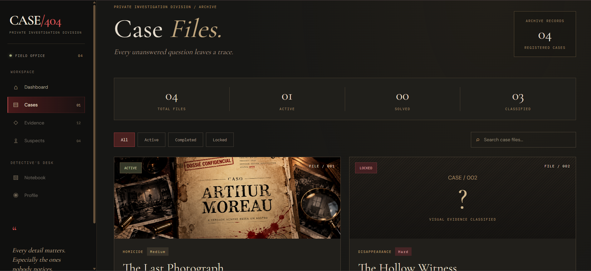

# CASE/404

<p align="center">
  <strong>EVERY CASE LEAVES A TRACE. EVERY TRACE TELLS A STORY.</strong>
</p>

<p align="center">
  A cinematic detective investigation experience built with Angular.
</p>

---

## Preview

<p align="center">
  
</p>

<p align="center">
  
</p>

## About the Project

**CASE/404** is a detective investigation game where players step into the role of a private investigator, explore mysterious cases, examine evidence, and uncover the truth behind each crime.

Inspired by noir detective stories, the project combines an immersive visual atmosphere with an interactive investigation interface.

The goal is to create an experience where every detail matters and every decision brings the detective closer to the truth.

## Features

- **Detective Dashboard** — An overview of the investigation workspace.
- **Case Archive** — Browse cases and explore their details.
- **Case Filtering** — Search cases and filter them by status.
- **Investigation Interface** — A foundation for managing suspects, evidence, and case progress.
- **Noir Visual Identity** — A cinematic interface inspired by classic detective stories.

## Tech Stack

| Technology | Purpose |
|---|---|
| Angular | Frontend framework |
| TypeScript | Application logic |
| HTML5 | Application structure |
| SCSS | Styling and visual design |
| LocalStorage | Planned local data persistence |

## Getting Started

### Prerequisites

- Node.js
- npm
- Angular CLI (optional)

### Installation

1. Clone the repository:

   ```bash
   git clone https://github.com/vziz1312/case404.git
   ```

2. Navigate to the project directory:

   ```bash
   cd case404
   ```

3. Install dependencies:

   ```bash
   npm install
   ```

4. Start the development server:

   ```bash
   npm start
   ```

5. Open your browser at:

   ```text
   http://localhost:4200
   ```

## Project Structure

```text
case404/
├── src/
│   ├── app/
│   │   ├── pages/
│   │   │   ├── dashboard/
│   │   │   └── cases/
│   │   ├── shared/
│   │   │   └── sidebar/
│   │   ├── app-routing.module.ts
│   │   └── app.module.ts
│   ├── assets/
│   │   └── images/
│   └── styles.scss
├── angular.json
├── package.json
└── README.md
```

## Development Roadmap

- [x] Project setup with Angular
- [x] Noir-inspired dashboard interface
- [x] Sidebar navigation
- [x] Case archive page
- [x] Case search and filtering
- [ ] Individual case investigation pages
- [ ] Suspect profiles and interrogation system
- [ ] Evidence collection and analysis
- [ ] Interactive investigation board
- [ ] Case progression and completion system
- [ ] Local data persistence

## Project Status

**In development.**

CASE/404 is an ongoing project. New investigation mechanics and features are being developed progressively.

---

<p align="center">
  <strong>CASE/404</strong><br>
  <em>Some truths are better left buried.</em>
</p>

<p align="center">
  Developed by <a href="https://github.com/vziz1312">vziz1312</a>
</p>